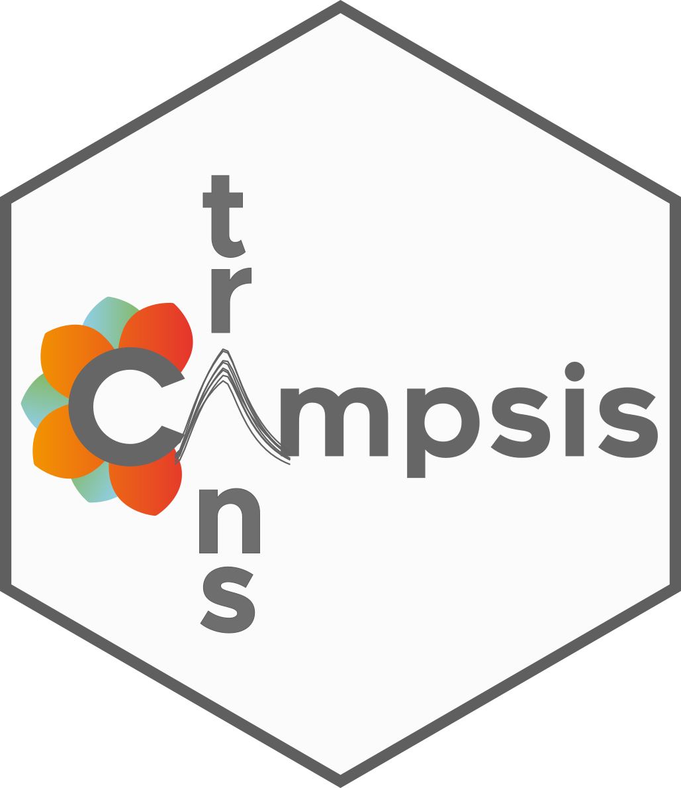
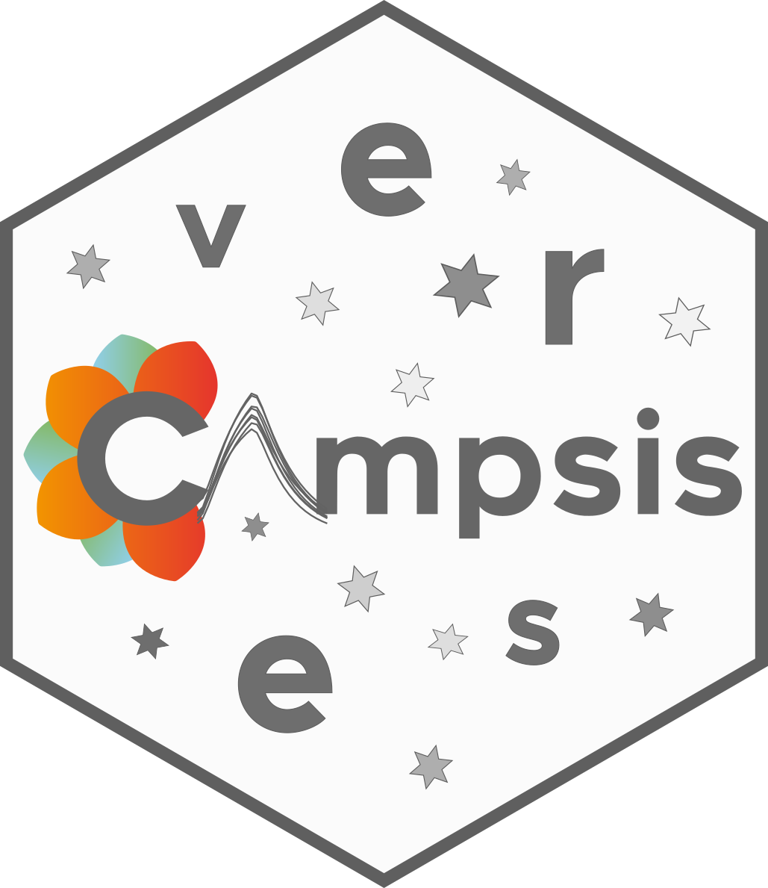

```{r setup, include = FALSE}
source("_R/campsis_setup.R")
```


Welcome to the official website of the Campsis suite.

Campsis is an open-source PK/PD simulation platform for R, originally created and sponsored by [Calvagone](https://www.calvagone.com) and now actively maintained and extended within the [campsisverse](https://github.com/campsisverse) ecosystem with support from [Lynxsoft](https://lynxsoft.be). All R packages in the suite are open-source on GitHub, while [e-Campsis](https://www.e-campsis.com/) provides a commercial interface built on top of them. Packages that are available on CRAN are shown with their badge.

Want to learn more? Please visit our section [What is Campsis](./intro.html).  
Want to give it a try? Please follow the [Installation](./install.html) instructions and have a look at the documentation below.

## Our suite of packages

<div class="level">
<div class="column-left">
<a href="https://github.com/campsisverse/campsis"></a>
</div>

<div class="column-right" style="padding-left: 30px;">

#### [campsis](https://github.com/campsisverse/campsis)

A generic PK/PD simulation platform based on rxode2 and mrgsolve engines.  
Please check out our [documentation](https://campsisverse.github.io/campsis.doc/).  
This package is available on [](https://cran.r-project.org/package=campsis)

</div>
</div>

<!-- Separator -->

<div class="level">
<div class="column-left">
<a href="https://github.com/campsisverse/campsismod"></a>
</div>

<div class="column-right" style="padding-left: 30px;">

#### [campsismod](https://github.com/campsisverse/campsismod)

Generic implementation of a drug model in pharmacometrics.  
Please check out our [documentation](https://campsisverse.github.io/campsismod.doc/).  
This package is available on [](https://cran.r-project.org/package=campsismod)
</div>
</div>

<!-- Separator -->

<div class="level">
<div class="column-left">
<a href="https://github.com/campsisverse/campsisnca"></a>
</div>

<div class="column-right" style="padding-left: 30px;">

#### [campsisnca](https://github.com/campsisverse/campsisnca)

Analyse your simulation output using non-compartmental analysis (NCA).   
Please check out the [README](https://github.com/campsisverse/campsisnca?tab=readme-ov-file) on GitHub. It contains many useful examples.  
This package is available on [](https://cran.r-project.org/package=campsisnca)

</div>
</div>

<!-- Separator -->

<div class="level">
<div class="column-left">
<a href="https://github.com/campsisverse/campsismisc"></a>
</div>

<div class="column-right" style="padding-left: 30px;">

#### [campsismisc](https://github.com/campsisverse/campsismisc)

Easily perform forest plots and sensitivity analyses using Campsis.   
Please check out the [README](https://github.com/campsisverse/campsismisc?tab=readme-ov-file) on GitHub. It contains many useful examples.

</div>
</div>

<!-- Separator -->

<div class="level">
<div class="column-left">
<a href="https://github.com/campsisverse/campsisqual"></a>
</div>

<div class="column-right" style="padding-left: 30px;">

#### [campsisqual](https://github.com/campsisverse/campsisqual)

Qualify your installation of the Campsis suite and generate an IQ/OQ report.   
Please check out the [README](https://github.com/campsisverse/campsisqual) for more information.

</div>
</div>

<!-- Separator -->

<div class="level">
<div class="column-left">

</div>

<div class="column-right" style="padding-left: 30px;">

#### [campsistrans](https://github.com/campsisverse/campsistrans)

Campsistrans is dedicated to importing models from a variety of sources. Currently, it imports your models from NONMEM control files (including parameter estimates and variance-covariance matrix), Monolix, and rxode2. Check out the [README](https://github.com/campsisverse/campsistrans?tab=readme-ov-file) on GitHub!

</div>
</div>

<!-- Separator -->

<div class="level">
<div class="column-left">

</div>

<div class="column-right" style="padding-left: 30px;">

#### [campsisverse](https://github.com/campsisverse/campsisverse)

Last but not least, Campsisverse is our package manager. It allows you to install the Campsis suite and its dependencies in one go. Based on `renv`, it ensures reproducibility of your simulation environment in R. Check out the [README](https://github.com/campsisverse/campsisverse?tab=readme-ov-file) on GitHub!

</div>
</div>

<!-- Separator -->

<div class="level">
<div class="column-left">
<a href="./ecampsis"></a>
</div>

<div class="column-right" style="padding-left: 30px;">

#### [e-Campsis](https://www.e-campsis.com/)

e-Campsis is an application that provides an intuitive and user-friendly interface for setting up population PK/PD simulations. Discover [e-Campsis](https://www.e-campsis.com/) here or check out our [documentation](https://Calvagone.github.io/ecampsis.doc/).

</div>
</div>

