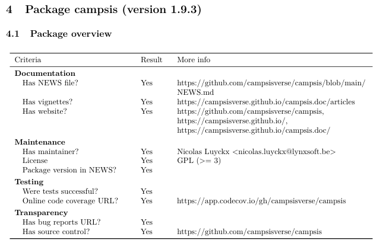
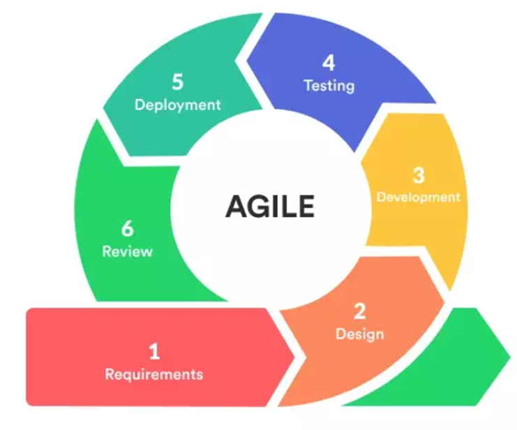

We are committed to developing high-quality open-source software that meets the rigorous standards of pharmaceutical research and development. Our quality assurance process, applied across all packages in the Campsis suite, is built on the following principles:

## Fully reproducible workflow

All simulations performed with the Campsis suite are fully reproducible. Because analyses are defined programmatically in R, scripts can be version-controlled, shared, and appended directly to Modeling & Simulation (M&S) reports.

To guarantee consistent environments across different machines, servers, and over time, we developed [`campsisverse`](https://github.com/campsisverse/campsisverse)—a dedicated package and environment manager built on top of `renv`. Each release of the Campsis suite is paired with its own `renv` lockfile included directly in `campsisverse`, locking the exact versions of all Campsis packages and their underlying dependencies.

With `campsisverse`, users can:

1. **Install a specific suite release:** Initialize a project environment pinned to any validated version of the Campsis suite.
2. **Restore exact dependencies:** Automatically recreate the exact package snapshot used to generate prior results.
3. **Guarantee long-term reproducibility:** Re-execute historical simulation scripts months or years later without breaking changes from upstream package updates.

## Qualification of the Campsis suite

While the Campsis suite can be easily installed via [`campsisverse`](https://github.com/campsisverse/campsisverse), regulated environments require documented evidence that the software operates as intended. To support this, we developed a dedicated qualification workflow to verify that the suite is properly installed and functioning across platforms (both local workstations and servers):

1. **Installation**: Install the Campsis suite in your R environment (see available installation options [here](https://github.com/campsisverse/campsisverse)).
2. **Qualification**: Execute the test suite using the [`campsisqual`](https://github.com/campsisverse/campsisqual) package, which runs over 2,000 automated tests to verify the integrity and behavior of the packages.
3. **Reporting**: Generate a comprehensive IQ/OQ report to serve as documented proof of qualification.

## Package quality assessment

Our report, besides showing the detailed results of the tests, also includes a quality assessment of every Campsis package. This assessment is based on the  [`riskmetric`](https://github.com/pharmaR/riskmetric) package suggested by the `R Validation Hub` consortium ([https://www.pharmar.org/riskmetric/](https://www.pharmar.org/riskmetric/) to assess the quality of an R package. 

- **Has NEWS file?**: This type of file is important to keep the users informed about the changes in the package.
- **Has vignettes?**: Vignettes are important to show the users how to use the package.
- **Has website?**: A website is important to provide more information about the package and keep the users informed.
- **Has maintainer?**: The maintainer is important to keep the package up-to-date.
- **Has license?**: A license is important to protect the package and the users. Our Campsis suite is licensed under the GPL-3 license. This basically means that you can use the software for free, you can modify it, and you can distribute it. However, if you distribute the software, you must also distribute the source code.
- **Package version in NEWS**: Is the current version of the packages detailed in the NEWS file? This is important to keep the users informed about the recent changes in the package.
- **Were tests successful?**: This is important to ensure that the package is working properly. This is a prerequisite for a successful qualification of the Campsis suite. All tests must pass.
- **Online code coverage URL?**: Code coverage is important to ensure that the package is well tested. The code coverage of the Campsis suite is available online at [codecov.io](https://codecov.io/gh/Calvagone).
- **Has bug reports URL?**: This is important to keep the users informed about the bugs in the package.
- **Has source control?**: Source control is important to track every change made to the package.

For illustration, the quality assessment of the Campsis suite printed out in the report is shown below:

{width=75%}

## Online GitHub repositories

All packages of the Campsis suite are hosted on GitHub. The source code of the packages is available online. The list of repositories is available on our [home page](./index.html).  

Pull requests are welcome. If you want to contribute to the Campsis suite, please contact [Lynxsoft](mailto:nicolas.luyckx@lynxsoft.be).

## Online code coverage

The code coverage of the Campsis suite is available online at [codecov.io](https://codecov.io/gh/campsisverse). The code coverage shows that our packages are extensively tested.

This online code coverage allows the end users to check, at any time and for each package, the percentage of code tested, but also:

- follow this percentage over time
- check the code coverage of every function or script
- have a better understanding of the quality of the package

## Software development life cycle

The development of the Campsis suite follows a software development life cycle (SDLC) based on the Agile methodology. The Agile methodology is a set of principles for software development in which requirements and solutions evolve through the collaborative effort within our team. It promotes adaptive planning, evolutionary development, early delivery, and continuous improvement, and it encourages rapid and flexible response to change.

{width=50%}

1. **Requirements**: Requirements are tracked on GitHub thanks to
    - Feedback from Calvagone/Lynxsoft staff
    - Community feedback
2. **Design**
    - Design is discussed internally at Calvagone/Lynxsoft
    - Code is object-oriented (use of S4 class system in R)
    - Functional programming using `purrr`
3. **Development**
    - R packages developed in RStudio
    - Use of Git as version control system
    - Use of Git branches (main/master, develop, feature branches)
    - Use of GitHub for collaboration
4. **Testing**
    - Unit tests, functional tests, non-regression and integration tests are implemented
    - Continuous integration using GitHub Actions (R CMD Check, run tests, build vignettes, code coverage)
    - Code is tested on Mac, Linux and Windows
5. **Deployment**
    - Packages released on GitHub/CRAN
    - Documentation is updated
    - Qualification reports are issued thanks to [`campsisqual`](https://github.com/campsisverse/campsisqual).
6. **Review**
    - Campsis used on a daily base at Calvagone/Lynxsoft for M&S projects
    - Feedback from the users is collected (online, during workshops) and is used to improve the software

